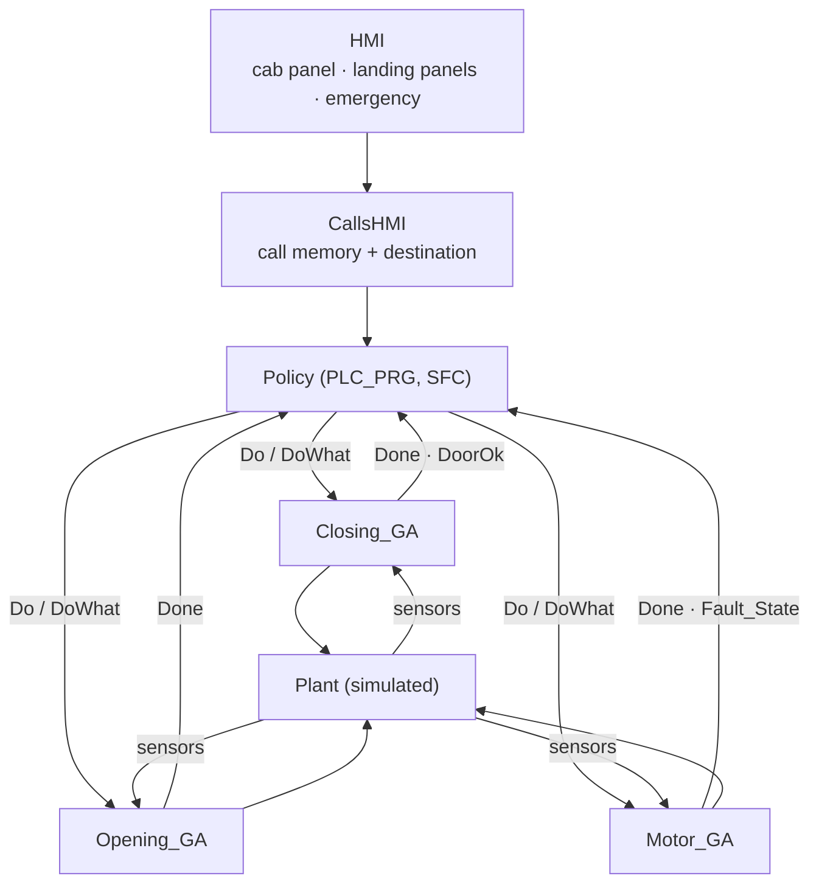
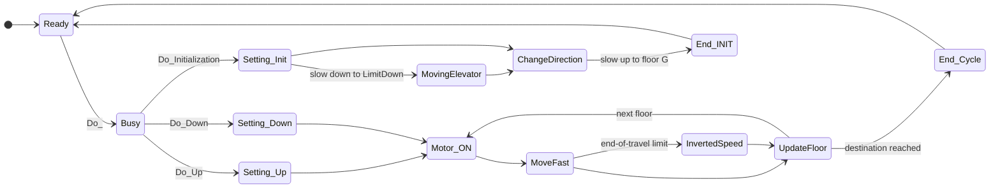

# PLC Control of an 8-Floor Elevator (CODESYS, IEC 61131-3)

Group project for the course **Ingegneria e Tecnologie dei Sistemi di Controllo T** (Logic Controllers), B.Sc. in Automation Engineering, **University of Bologna**, A.Y. 2024/2025.
Developed by **Nicola Gaiotto, Federico Rinieri and Almen Selimi**.

This is the logic control software for an elevator serving floors G–7, written in **CODESYS V3.5** using **Sequential Function Charts (SFC)** and **Structured Text (ST)**. It runs against a simulated plant with an HMI visualization. The controller:

- **homes** the cab automatically at start-up;
- **stores and dispatches calls** from the cab panel and the landing panels, including calls placed while the cab is moving;
- detects **faulty floor/ramp magnets** and handles the **emergency button**, always bringing the cab to a safe floor with the doors open.

---

## Architecture: Generalised Actuators + policy

The software follows the **Generalised Actuator (GA)** pattern. Each physical sub-system is wrapped in a function block with a uniform **Do / Done** handshake. Each GA owns its own sensors and actuators exclusively, and a separate **policy** program decides *what* to do and *when*.



| GA | Actions | Sensors | Actuators |
|---|---|---|---|
| `Closing_GA` | `Do_CloseDoor` | `Closed`, `Presence` (photocell) | `Closing` |
| `Opening_GA` | `Do_OpenDoor` | `Open` | `Opening` |
| `Motor_GA` | `Do_Up`, `Do_Down`, `Do_Initialization` | `RampSensor`, `DeckSensor`, `LimitUp`, `LimitDown` | `Motor_on`, `Up`, `Vel` |

All GAs share the same life cycle, **Init → Ready → Busy → Done**, exposed through a `State` output. Every request is a `Do_` pulse plus a `DoWhat` enumeration.

### Closing_GA / Opening_GA

Both door GAs drive the door until the end-of-stroke sensor is reached. `Closing_GA` also produces **`DoorOk`**: if the photocell detects a person while the door is closing, the closing is suspended, the policy reopens the door, and closing resumes once the passage is clear.

### Motor_GA

This GA handles every cab movement and keeps track of the current floor.



*(Simplified view of the SFC.)*

- **Homing (`Do_Initialization`):** the cab moves down at low speed to the lower limit switch, then up at low speed to floor G.
- **Travel (`Do_Up` / `Do_Down`):** each trip starts at low speed to leave the floor, continues at high speed between floors, and ends at low speed for precise levelling on the floor magnet. At floors G and 7, reaching a limit switch automatically reverses the direction.
- **Floor tracking:** `Current` is incremented or decremented at every floor according to the direction of travel.
- **Magnet fault detection:** the cab must see the sensors in the order *deck → ramp → ramp → deck*. A sensor sequence state machine flags any out-of-order detection as a fault:

  | Expected | Detected | Fault |
  |---|---|---|
  | after a deck magnet: ramp | deck | `MagnetRamp` |
  | after the 1st ramp: 2nd ramp | deck | `MagnetRamp` |
  | after the 2nd ramp: deck | ramp or limit switch | `MagnetDeck` |

## Policy

The policy is an SFC. At start-up it closes the doors (reopening them if the photocell is interrupted), homes the cab and opens the doors at floor G. It then cycles through **wait for a call → close doors → travel → open doors → wait → clear served calls**.

### Call memory

The 8 cab buttons (`IntPanel[0..7]`), 7 up-landing buttons (`ExtPanelUP[0..6]`) and 7 down-landing buttons (`ExtPanelDOWN[1..7]`) are latched into `CallInt`, `CallUp` and `CallDown`, and each latched call turns on its LED. A call is cleared, and its LED turned off, when the cab is at that floor with the doors fully open.

### Destination selection

The destination is recomputed every cycle from the call arrays, the current floor, the direction of travel and the emergency/fault status. Calls ahead of the cab in its current direction are served first, starting with the nearest. While the cab is moving, any new call between the current floor and the destination replaces the destination, so the cab stops **on the fly**:

```iecst
IF Motor_GA_0.DoWhat = Do_Up THEN
    FOR i := Current + 1 TO Destination - 1 DO     // nearest call on the way up
        IF CallInt[i] OR CallUp[i] OR CallDown[i] THEN
            Destination := i;
            EXIT;
        END_IF;
    END_FOR;
ELSIF Motor_GA_0.DoWhat = Do_Down THEN
    FOR i := Current - 1 TO Destination + 1 BY -1 DO  // nearest call on the way down
        IF CallInt[i] OR CallDown[i] OR CallUp[i] THEN
            Destination := i;
            EXIT;
        END_IF;
    END_FOR;
END_IF;
```

### Emergency

Pressing **Emergency** acts on all GAs immediately:

1. If the doors are closing, closing is aborted and the doors reopen.
2. Otherwise, the destination becomes the nearest floor in the current direction of travel, and the doors open there.
3. While the emergency is active, destination updates are frozen. Calls stay stored but are not served until the emergency is released.

### Sensor faults

When `Motor_GA` reports `MagnetDeck` or `MagnetRamp`, the matching alarm LED turns on and the policy applies a uniform strategy. The cab does **not** stop between floors; it continues to the next reachable floor. If the fault is detected at floor G or 7, the limit switch reverses the direction first. The doors then open with the standard sequence, and the system enters an **error state** that ignores all calls until a cold reset.

---

## Repository structure

```
├── codesys/
│   └── Elevator_Control.project   CODESYS V3.5 project (GAs, policy, plant simulation, HMI)
└── docs/
    └── report_it.pdf              Project report (Italian)
```

The plant simulation (cab kinematics, doors, floor/ramp magnets, limit switches) and the HMI are included in the same project.

## How to run

1. Install **CODESYS V3.5** (SP21 or newer; the project uses 3.5.21 libraries) with the CODESYS Control Win soft-PLC.
2. Open `codesys/Elevator_Control.project`.
3. Choose **Online → Simulation**, then **Login** and **Start**.
4. Open the **Visualization** to press floor buttons, trigger the emergency and watch the cab.

## Authors

- Nicola Gaiotto
- Federico Rinieri
- Almen Selimi

University of Bologna, Ingegneria e Tecnologie dei Sistemi di Controllo T, A.Y. 2024/2025.
